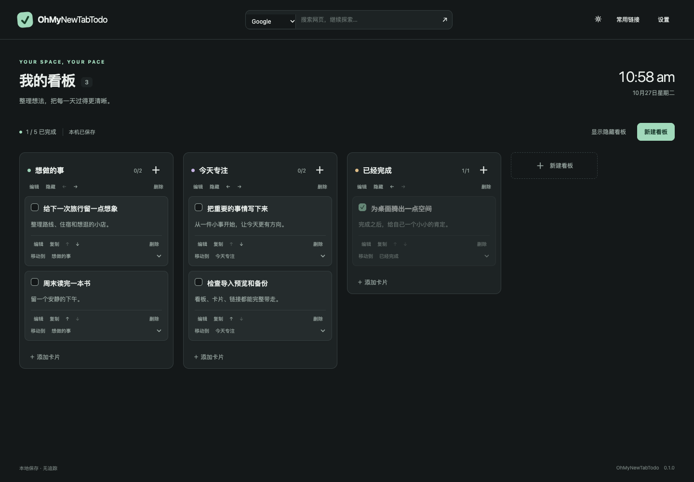

# OhMyNewTabTodo

[简体中文](README.md) · [Upgrade comparison](docs/features.en.md) · [Downloads](https://github.com/sdzcgaoxiang/OhMyNewTabTodo/releases)

Organize your tasks whenever you open a new tab: familiar horizontal boards, local storage, and backups you can inspect, restore, and take with you.

This is an independent, MIT-licensed implementation inspired by NewTabTodo. It is unaffiliated with the original author and does not include the original code or assets.

## Why switch from NewTabTodo?

Version **0.1.0** keeps familiar board interactions while improving migration, backups, and editing across tabs. Comparisons refer to the audited **NewTabTodo 0.2.0**.

| Your concern | Improvements available now |
| --- | --- |
| The original export is reported as corrupt on import | Accepts missing bookmark fields and previews data before confirmation |
| Data exists in the file but is missing from view | Preserves and optionally recovers undisplayed boards and unassigned cards |
| Repeated imports create copies, or replacement feels risky | Explicit merge / replace / copy modes, conflict reporting, and up to three pre-operation recovery points |
| You want to carry tasks and preferences with you | Full backups include settings, theme, and unknown business fields without inheriting the original bookmark truncation rules |
| Open tabs overwrite each other's changes | Receives updates and preserves drafts when stale edits conflict |
| You want to inspect and maintain your tool | MIT source, public build instructions and tests, and no telemetry uploads |

**Current tradeoffs: no automatic Chrome cross-device sync, manual installation and updates, and a Chinese UI.** Bilingual documentation is not UI localization. If automatic sync is essential, this is not yet a complete replacement. Recovery points are not an undo history for ordinary edits/deletions; keep external backups.

[Read the detailed comparison, scenarios, and evidence →](docs/features.en.md)



## Features

- Create, rename, hide, and reorder boards; edit, copy, complete, delete, and move cards using drag-and-drop or buttons.
- Descriptions, links, priorities, labels, dates/times, and today / tomorrow / overdue indicators; compact and completed-card display options.
- Light/dark themes, quick links, search entry points, and a 12/24-hour date/time clock.
- NewTabTodo 0.2.0 JSON import, legacy-format export, full backups, import previews, and recovery points.
- Cross-tab updates, edit-conflict notices, and save-failure feedback.

No account, telemetry, backend, or automatic cross-device synchronization. This version is not listed in the Chrome Web Store.

## Installation and updates

1. Download `OhMyNewTabTodo-0.1.0.zip` from [Releases](https://github.com/sdzcgaoxiang/OhMyNewTabTodo/releases) and extract it to a permanent directory.
2. Open `chrome://extensions`, enable **Developer mode**, choose **Load unpacked**, and select the directory containing `manifest.json`.
3. Open a new tab. If another new-tab extension takes precedence, temporarily disable it; retain the original extension and export until migration is verified.

Before updating, export a full backup. Replace files in the **same directory** and click Reload in Chrome's extension manager. Do not uninstall first: uninstalling deletes local data, and changing the directory can change the extension identity and storage. Minimum declared version: Chrome 120. Acceptance tests run against Playwright's bundled Chromium, not every supported Chrome version.

## Migrate from NewTabTodo

1. Export JSON from the old extension and retain the original file.
2. Open Settings → Import / Export (`设置 → 导入 / 导出`), choose the file, and review counts and warnings.
3. Missing `bookmarks` is supported. Boards absent from display order and unassigned cards are preserved; choose recovery if you want them displayed.
4. Choose a mode, confirm, verify your content, and export a full backup.

| Mode | Behavior |
| --- | --- |
| Merge / 合并 (default) | Skips identical objects with the same IDs; conflicting board/card/bookmark IDs stop the import. Preserves distinct bookmark IDs and local preferences. |
| Replace / 替换 | Replaces boards, cards, and bookmarks after confirmation. A full backup also restores settings/theme; a legacy file retains local preferences. |
| Copy / 作为副本 | Gives imported boards/cards new IDs. Identical same-ID bookmarks are skipped; conflicting bookmarks receive new IDs. Retains local preferences. |

If data changes after preview, select the file again. Invalid references or unsupported backup versions are rejected before writing. Legacy exports omit settings, theme, and recovery points; they cannot fix defects or truncation in the original importer. Use **Export full backup / 导出完整备份** for routine backups.

## Storage and limits

Production data lives in the current Chrome profile's `chrome.storage.local`, in one versioned `app_state` record. The background service worker serializes writes from fresh state and reports success only after persistence. The original `boards / cards / boardOrder` business structure and unknown business fields are retained.

The input limit is **5 MiB**; the default local storage quota is **10 MB**, shared with up to three recovery snapshots. Even a smaller file may exceed the remaining quota. Failed writes preserve existing data and report an error; recovery points are not silently removed to make room. They cannot protect against uninstalling, profile loss, or disk failure. Transfer full backups manually between computers.

Changing the local database would not remove the limits of a future `chrome.storage.sync` transport. See the [storage decision (Chinese)](docs/research/data-layer-options.md) and [Chrome Storage API](https://developer.chrome.com/docs/extensions/reference/api/storage).

## Development and verification

Use Node.js 22.12+, npm, and `zip` / `unzip`. macOS provides these archive tools; install them through your Linux package manager, or use WSL on Windows.

```sh
npm ci
npx playwright install chromium
npm run check
npm run package
```

- `npm run dev`: Vite development UI with separate site localStorage.
- `npm run typecheck`: strictly check TypeScript application code, tests, and build configuration.
- `npm test`: run model, transfer, persistence, date, and packaging tests.
- `npm run format` / `npm run format:check`: format or check source style.
- `npm run build`: typecheck, then create loadable `dist/` output.
- `npm run test:e2e`: test the built extension in temporary Chromium profiles, without accessing your everyday Chrome profile.
- `npm run package`: rebuild, package allowlisted assets and license notices, and generate a SHA-256 checksum in `release/`.

CI checks pushes and PRs. Version tags trigger validation and release packaging. Never commit real exports or browser profiles as fixtures.

## Documentation and contributions

[Features](docs/features.en.md) · [Release documentation checklist](docs/releasing.md#english-release-checklist) · [Repository guidelines](AGENTS.md) · [License](LICENSE)

The [design](docs/superpowers/specs/2026-10-27-v1-design.md), [0.1.0 verification record](docs/verification-v0.1.0.md), [TypeScript migration verification](docs/verification-typescript-migration.md), [contribution guide](CONTRIBUTING.md), and [privacy policy](PRIVACY.md) are currently Chinese or bilingual. Use synthetic reproductions in [Issues](https://github.com/sdzcgaoxiang/OhMyNewTabTodo/issues), without personal task content.

Application source, tests, and development configuration use TypeScript; `scripts/package.mjs` remains directly executable by Node. Maintenance follows specifications and test-driven development. Every release reviews the paired README and feature pages, changelog, and verification record. Update both user-documentation languages in the same PR; preserve historical audit and release evidence.
