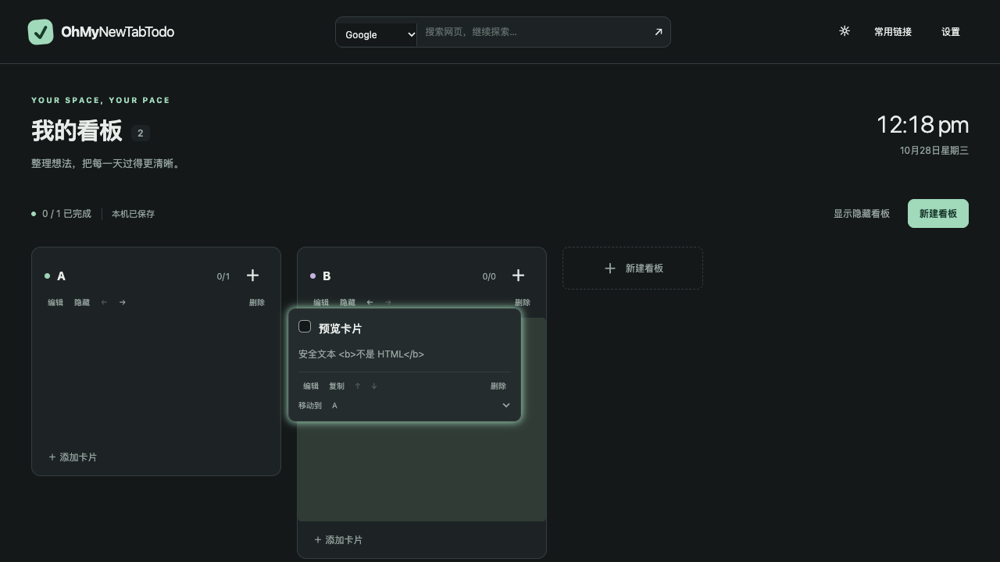

# OhMyNewTabTodo

[English](README.en.md) · [升级特性对比](docs/features.md) · [下载](https://github.com/sdzcgaoxiang/OhMyNewTabTodo/releases)

打开新标签页，整理你的待办。熟悉的横向看板、本地保存的数据，以及可以检查、恢复和带走的备份。

这是受 NewTabTodo 使用体验启发的独立实现，项目采用 MIT 许可，与原作者无关联。原版代码和素材不在本仓库中；安装包中的第三方依赖许可见 `LICENSE.txt`。

## 为什么从 NewTabTodo 迁移

当前版本 **0.2.0** 恢复原版拖动中的占位和预览反馈，并改进旧文件迁移、备份恢复和多标签页编辑。下表对比基于已审计的 NewTabTodo **0.2.0**。

| 你遇到的问题 | 新版已经提供的改进 |
| --- | --- |
| 原版导出后又提示文件损坏 | 兼容缺失书签字段，先预览再确认导入 |
| 数据在文件里，却没有显示出来 | 保留并可选择恢复未显示看板、孤立卡片 |
| 重复导入产生副本，或者担心误替换 | 合并 / 替换 / 副本三种模式，明确冲突，最多 3 个操作前恢复点 |
| 想把数据和使用设置完整带走 | 完整备份包含设置、主题和未知业务字段；不沿用原书签截断规则 |
| 多个标签页相互覆盖修改 | 及时接收更新，过期编辑提示冲突并保留草稿 |
| 拖动时看不清目标位置 | 拖动中显示占位、相邻项让位、目标列高亮和卡片阴影 |
| 希望可以检查和维护自己的工具 | MIT 开源，公开构建与测试，无遥测上传 |

**当前限制：没有 Chrome 跨设备自动同步，需要手动安装和更新，界面目前为中文。** 如果你依赖自动同步，这一版还不是完整替代。恢复点不是普通编辑/删除的撤销历史，仍需外部备份。

[查看完整对比、使用场景与验证依据 →](docs/features.md)




## 当前版本提供什么

- 看板新增、改名、隐藏、排序；卡片编辑、复制、完成、删除和跨看板移动，支持拖拽与按钮操作。
- 卡片描述、链接、优先级、标签、日期时间及今天 / 明天 / 过期提示；紧凑模式、隐藏或淡化完成项。
- 深浅主题、常用链接、搜索引擎入口、12/24 小时时钟与日期。
- NewTabTodo 0.2.0 JSON 兼容导入、原版格式导出、包含设置的完整备份。
- 导入预览、合并 / 替换 / 副本模式、残留看板和孤立卡片恢复、最近 3 个恢复点。
- 多标签页更新通知、过期编辑冲突提示、保存失败反馈。

无账号、无统计上传、无后端、无跨设备自动同步。当前版本未发布到 Chrome Web Store，安装使用解压目录。

## 安装与更新

1. 从 [Releases](https://github.com/sdzcgaoxiang/OhMyNewTabTodo/releases) 下载 `OhMyNewTabTodo-0.2.0.zip` 并解压到固定目录。
2. Chrome 打开 `chrome://extensions`，开启「开发者模式」，选择「加载已解压的扩展程序」，选中包含 `manifest.json` 的目录。
3. 打开新标签页。若 Chrome 仍使用其他新标签页扩展，可在扩展管理中暂时停用它；迁移完成前保留旧扩展及导出文件。

更新前先导出完整备份。把新版文件替换到**同一目录**，在扩展管理中点击重新加载；不要先卸载扩展。改变解压目录可能改变扩展身份及本地存储，卸载会删除本地数据。最低 Chrome 120；自动化验收使用 Playwright 随附 Chromium，未逐版测试所有 Chrome 版本。

## 从 NewTabTodo 迁移

1. 在原插件中导出 JSON，保留一份原始文件。
2. 新扩展打开「设置 → 导入 / 导出」，选择该文件，核对看板、卡片和链接数量。
3. 查看警告：原版可能未导出 `bookmarks`，也可能存在未列入显示顺序的看板。此版本会兼容缺失书签并保留这些数据，可勾选恢复显示；不根据猜测删除。
4. 选择导入方式并确认。新安装可使用默认「合并」；导入成功后核对内容，再导出一份完整备份。

| 模式 | 行为 |
| --- | --- |
| 合并（默认） | 相同 ID、相同内容跳过；任务 / 看板 / 书签 ID 内容冲突时整次停止；不同 ID 的书签及其元数据均保留。保留本机设置。 |
| 替换 | 替换看板、卡片、书签，需要明确确认；完整备份同时恢复设置和主题，旧格式保留本机设置。 |
| 作为副本 | 为导入看板和卡片分配新 ID，保留当前内容；相同 ID 且内容相同的书签跳过，冲突时使用新 ID。保留本机设置。 |

预览后发生任何数据修改，需要重新选择文件再确认。单文件上限 **5 MiB**；非法 ID、引用关系或不支持的备份版本会拒绝导入，原数据不变。原版格式导出保留业务字段，但不包含设置、主题或恢复点；它并不能修复旧插件本身的导入缺陷，也不能保证旧插件无截断地接收数据。日常备份请使用「导出完整备份」。

## 数据与容量

正式扩展把数据保存在当前 Chrome 配置的 `chrome.storage.local` 中，单个 `app_state` 记录包含版本号、任务数据和最多 3 份恢复快照。只有后台 service worker 可以写入；修改排队后读取最新状态，保存成功才通知页面。旧模型的 `boards / cards / boardOrder` 和未知业务字段继续保留。

本地存储默认配额为 10 MB，恢复点也占用空间，因此 5 MiB 以内文件仍可能因配额而无法导入。失败会显示错误，并保留之前的数据；不会静默删除恢复点以腾出空间。恢复点不等于外部备份，不能抵御卸载、浏览器配置丢失或磁盘故障。跨电脑请手动导出 / 导入完整备份。

更换数据库只能改变本地存储，不能改变未来同步通道的限制：如果以后使用 `chrome.storage.sync` 传输数据，仍受该 API 的总量、单项大小与写入频率限制。详见[数据层决策](docs/research/data-layer-options.md)及 [Chrome Storage API](https://developer.chrome.com/docs/extensions/reference/api/storage)。

## 开发与验证

需要 Node.js 22.12+、npm，以及 `zip` / `unzip`（macOS 自带；Linux 可通过包管理器安装；Windows 建议 WSL）。

```sh
npm ci
npx playwright install chromium
npm run check
npm run package
```

- `npm run dev`：浏览器界面开发，使用当前站点 localStorage 中的独立演示数据，与扩展数据隔离。
- `npm run typecheck`：严格检查 TypeScript 业务源码、测试和构建配置。
- `npm test`：使用 Node runner 与 `tsx` 执行纯模型、导入导出、存储并发/失败、安装包测试。
- `npm run format` / `npm run format:check`：统一源码格式 / 检查格式，便于维护和审查。
- `npm run build`：先做类型检查，再生成可加载的 `dist/`。
- `npm run test:e2e`：在独立临时 Chromium 配置加载已构建扩展，验证多页面、文件传输与 UI；不访问你的日常 Chrome 配置。
- `npm run package`：重建并生成 `release/OhMyNewTabTodo-0.2.0.zip` 和 `SHA256SUMS.txt`，只打包白名单扩展资源。

CI 在提交和 PR 上运行完整检查。维护者创建 `v<package.json version>` tag 时，发布工作流重新验收并上传安装包和校验和；不能把 `reference/` 或任何真实个人备份作为测试样本提交。

## 设计与维护

[设计规格](docs/superpowers/specs/2026-10-27-v1-design.md) · [执行计划](docs/superpowers/plans/2026-10-27-v1.md) · [0.2.0 验收](docs/verification-v0.2.0.md) · [0.1.0 历史验收](docs/verification-v0.1.0.md) · [TypeScript 迁移验收](docs/verification-typescript-migration.md) · [原版兼容调研](docs/research/newtabtodo-compatibility.md) · [功能审计](docs/research/newtabtodo-audit.md) · [贡献指南](CONTRIBUTING.md) · [隐私说明](PRIVACY.md)

业务源码、测试及开发配置采用 TypeScript；发布脚本 `scripts/package.mjs` 保持可由 Node 直接执行。维护遵循 spec + 测试驱动：先约定可观察行为，再用合成数据写失败测试，完成实现后更新文档。数据格式变更必须有版本与迁移策略；没有自动同步的隐含承诺。第一版重点是可靠迁移和本机使用，欢迎通过 [Issues](https://github.com/sdzcgaoxiang/OhMyNewTabTodo/issues) 提供可脱敏复现的问题。

每次版本发布必须按[双语文档更新清单](docs/releasing.md)检查 README、特性说明、变更日志和验收记录；中英文用户文档在同一个 PR 中同步，历史审计和已发布版本记录保留原有范围。
