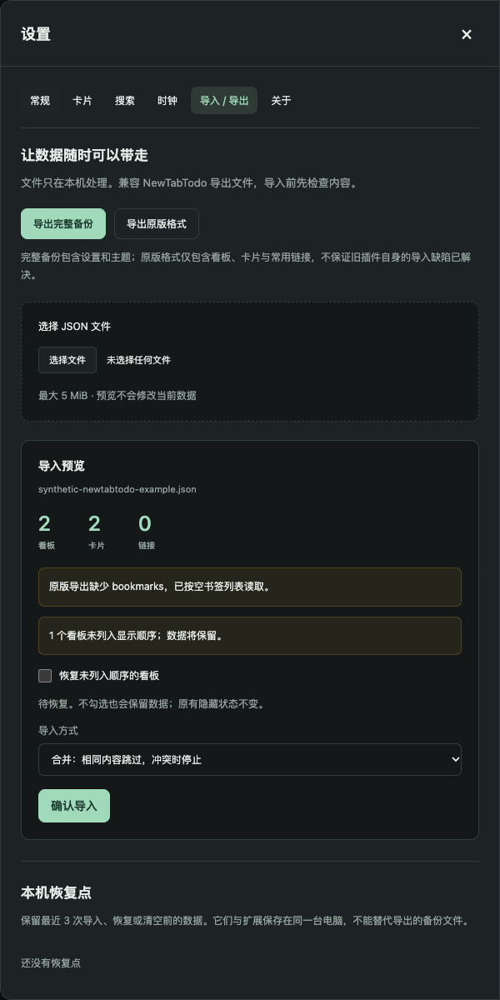

# 为什么从 NewTabTodo 迁移？

[English](features.en.md) · [安装与迁移](../README.md) · [下载 v0.1.0](https://github.com/sdzcgaoxiang/OhMyNewTabTodo/releases/tag/v0.1.0)

适用版本：**OhMyNewTabTodo 0.1.0**。对比基线：已审计的 **NewTabTodo 0.2.0**。核对日期：2026-10-27。

OhMyNewTabTodo 保留熟悉的横向看板，让旧数据更容易迁移、备份和恢复，并减少多标签页编辑时的意外覆盖。它是 MIT 开源的独立替代项目，与 NewTabTodo 原作者无关联，并非官方升级或原版源码分支。

**适合谁：**依赖 NewTabTodo 的看板习惯，希望继续本机使用，同时改善数据导入、备份和可维护性的用户。**如果你依赖 Chrome 自动跨设备同步，目前不适合作为完整替代。** 当前界面为中文；双语说明不代表界面已经支持英文。

## 熟悉的功能继续保留

- 横向看板、排序、隐藏与恢复显示；卡片拖拽、复制、编辑、完成和删除。
- 描述、链接、优先级、两个标签入口、日期时间与今天 / 明天 / 过期提示。
- 深浅主题、紧凑模式、隐藏完成项、常用链接、搜索入口及日期时钟。

这些是延续的使用习惯，不作为新增升级宣传。界面采用独立设计，不逐像素复刻原版。

## 已实现的升级

| 使用场景 | NewTabTodo 0.2.0 的已审计行为 | OhMyNewTabTodo 0.1.0 的改进 |
| --- | --- | --- |
| 导出的文件又导不回去 | 导出可能省略 `bookmarks`，导入却要求它是数组，因而报文件损坏 | 兼容缺失书签字段；先显示数量、警告与恢复选项，再确认导入 |
| 有些看板在文件里，界面却看不到 | 导出包含未列入显示顺序的残留对象，原导入路径处理异常 | 保留这些看板和孤立卡片，允许显式恢复；不猜测它们应被删除 |
| 导入后内容被截短或减少 | 原书签导入路径最多保留 15 项，并截短名称 | 不沿用这些截断规则；保留长标题、书签及未知业务字段，仍受整体容量限制 |
| 重复导入同一份备份 | 每次重建任务 ID，可能不断添加副本 | 合并时相同 ID、相同内容跳过；不同内容提示冲突。需要复制时可明确选择“作为副本” |
| 想恢复使用设置 | 原导出不包含完整设置和主题，按白名单挑选业务字段 | 完整备份包含任务、链接、设置、主题和未知业务字段；同时提供旧格式导出 |
| 替换错了或清空后想找回 | 原数据路径没有本版的导入预览和恢复点机制 | 替换需确认；保留最近 3 个导入、恢复或清空前的恢复点 |
| 同时开着多个新标签页 | 页面持有旧快照，保存可能覆盖另一页的新修改 | 页面订阅更新；编辑检查内容及所属看板，冲突时保留草稿；过期导入预览不能提交 |
| 保存失败、删除后又出现旧对象 | 写入错误可能被忽略；删除后的旧存储键可能残留 | 保存成功才报告成功；失败明确提示；保存状态真实反映删除结果 |

“相同 ID 跳过”指标准旧导出中带有 ID 的对象；文件内容有冲突时不会擅自覆盖。额外标签和未知业务字段在普通编辑中继续保留。

## 开源与隐私

代码、构建步骤、测试和版本记录公开，采用 [MIT 许可](../LICENSE)，可以自行检查和维护。新版不包含遥测、账号或后台上传服务，不沿用原版审计发现的统计/反馈接口；这并不意味着已经验证过原服务器收到哪些数据。

任务与备份在本机处理。主动搜索或打开外链时，浏览器仍会访问目标网站。详见[隐私说明](../PRIVACY.md)。

## 三个迁移场景

**旧插件提示 “file corrupted”。** 在新版「设置 → 导入 / 导出」选择原文件。缺失 `bookmarks` 会显示兼容提示；其他非法结构仍会拒绝，不会把所有坏文件都当成可恢复文件。

**想找回没有显示的看板。** 核对预览中的数量与名称，勾选恢复未列入顺序的看板；孤立卡片可恢复到新看板。不勾选也保留数据，原有隐藏状态不会自动取消。

**想用另一份文件替换当前数据。** 选择“替换”并确认。提交前保留恢复点，必要时可从「本机恢复点」恢复。完整备份在替换模式恢复设置和主题；合并和副本模式保留本机设置。

## 迁移步骤

1. 从原版导出 JSON，保留原文件及旧扩展。
2. [下载并安装新版](../README.md#安装与更新)，在设置中选择 JSON，核对数量和警告。
3. 初次迁移默认使用“合并”；根据预览决定是否恢复未显示对象，然后确认。
4. 检查看板、卡片、标签和链接，再导出一份完整备份。确认可用后再决定是否停用原扩展。

## 目前需要接受的边界

- **没有跨设备自动同步**；跨电脑使用完整备份手动导入/导出。同浏览器多标签页更新不是跨设备同步。
- **手动安装和更新**；未上架 Chrome Web Store。更新时保留原安装目录，先备份再重新加载，避免先卸载。
- **文件上限 5 MiB，本地默认配额 10 MB**，恢复点也占空间；文件未超限仍可能因总容量而保存失败。
- 恢复点只覆盖会改变数据的导入、恢复和清空操作，**不是普通编辑/删除的逐步撤销记录**，也不能替代外部备份。完整备份不递归携带恢复点。
- 不能还原旧导出器已经丢失的字段；未承诺所有历史格式兼容。新版旧格式导出也不能修复原插件的导入缺陷。

## 对比依据与维护

原版事实见[兼容调研](research/newtabtodo-compatibility.md)和[能力审计](research/newtabtodo-audit.md)；新版验证见[0.1.0 验收记录](verification-v0.1.0.md)、[导入测试](../tests/transfer.test.js)、[持久化测试](../tests/repository.test.js)与[浏览器验收](../tests/browser/extension.spec.js)。证据不等于所有环境下的绝对保证。

每次版本更新，按[发布文档清单](releasing.md)同步检查中英文说明。计划中的功能不混入“已实现的升级”。
